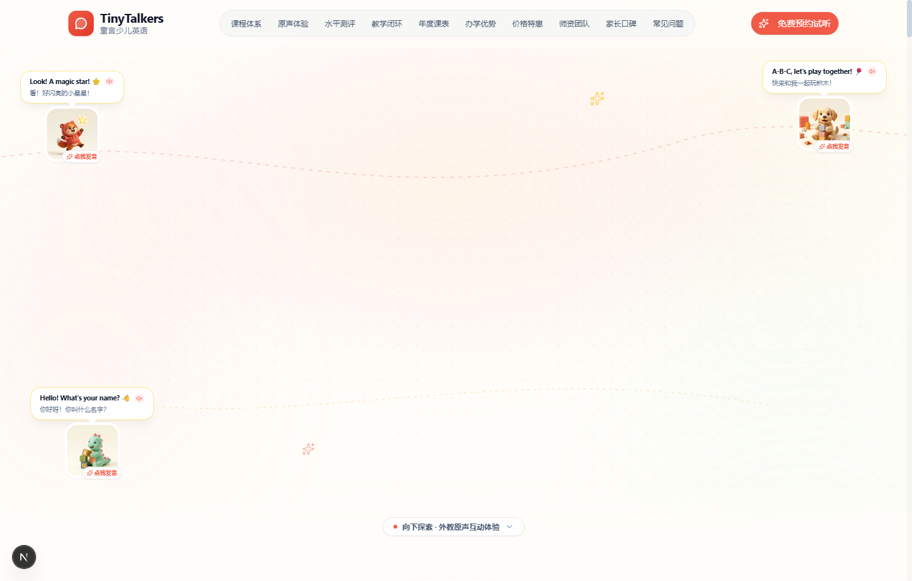

# TinyTalkers 童言少儿英语 🌟

> **双语未来，从小自信开口**  
> 面向 3–12 岁少儿的高端分龄英语学习机构官网与沉浸式交互平台。



---

## 🤖 AI 智能体与 Skill 协同生成说明

本项目全案重构由 **Google Antigravity Agent (Gemini)** 与开源顶级前端设计工程 Skill **[`pbakaus/impeccable`](https://github.com/pbakaus/impeccable)** 协同结对编程驱动完成：

1. **AI 架构师与结对编程**：基于 **Antigravity (Gemini)** 模型完成从 Next.js 15 至 **Next.js 16.4.5 (Turbopack)** 与 **React 19.3.1** 的内核升级，建立平级工程规范、TypeScript 5 强类型安全与 ESLint 9 Flat Config。
2. **Impeccable 设计哲学与工程规范**：
   - **Persuade 模式**：通过严密的学习闭环、名师实证、透明对比矩阵与学费明细构建高转化信赖感体系。
   - **Craft Floor 工业级标准**：消除所有低质 AI Slop 风格；严格遵守 WCAG AA/AAA 对比度规范（标题文本 Slate 900 对比度 > 10:1）；全面废除 Emoji 图标，改用定制语义化 Lucide 图标与纯 SVG；严禁弹跳（bounce）抖动，统一采用优雅平滑的 `easeInOut` 正弦波形缓动。
   - **设计工程资产**：项目沉淀了核心产品规格说明书 [`PRODUCT.md`](./PRODUCT.md) 与设计系统规范文档 [`DESIGN.md`](./DESIGN.md)。
3. **AI 3D 视觉艺术资产生成**：通过专门的图像生成子智能体（Image Generator Subagent），原创生成了整套符合 Pixar / 黏土定格动画风格的品牌 3D 吉祥物与玩偶矩阵（`/public/mascots/`）。

---

## 🚀 核心亮点与交互功能

### 1. 首屏生动叙事与嬉戏玩偶交互
- **立体玩偶伴学**：吉祥物小狐拓 Toby、积木萌犬 Buddy 与小恐龙 Dino 浮动陪伴于首屏侧翼。
- **一键原声朗读**：点击玩偶或对白气泡（如 *“Look! A magic star! ⭐”*、*“A-B-C, let's play together! 🎈”*），即可通过浏览器原生 **Web Audio API** 提示音与 **Web Speech Synthesis API** 实时播放纯正地道少儿英语童音。
- **有机弧线水波过渡**：首屏底部通过羽化渐变与有机水波凹弧衔接下一屏，配备悬浮互动纽带按钮一键平滑滚动直达互动体验馆。

### 2. 外教原声互动体验馆 (Soundboard)
- 沉浸式听觉实验室，内置自然拼读短元音、双元音、生活高频词汇与趣味情景例句。
- 动态音频声波频谱（Soundwave Spectrum），直观呈现发音节奏与音调律动。

### 3. 60 秒智能分阶测评工具 (Interactive Assessment)
- 无需繁琐注册，家长只需选择“孩子年龄段”、“当前英语基础”与“核心培养目标”，算法即刻智能匹配推荐最佳阶梯课程与专属学习路径规划。

### 4. 三大科学课程分阶体系
- **启蒙期（3–6 岁）**：TPR 全身反应法、原版绘本磨耳朵、多感官趣味情景。
- **系统学习期（6–10 岁）**：自然拼读 44 核心音素、牛津阅读树分级阅读、高频独立整句表达。
- **强化期（10 岁+）**：对标剑桥 KET / PET 国际官方认证、青少年辩论工作坊与学术演讲思辨。

### 5. 沉浸式 5 步教学闭环 (Learning Loop)
- 严密成长生态：**课前 5min 趣味微课** $\to$ **课中 40min 沉浸情景互动** $\to$ **课后 10min 外教定制口型打卡** $\to$ **当堂中英双语学情卡** $\to$ **阶段学术展演与荣誉见证**。

### 6. 专业核心维度对比矩阵 (Comparison Matrix)
- 深度对比传统 15–25 人应试大班与 TinyTalkers 6–8 人精品小班在“开口率”、“教学理念”、“师资认证”、“调课保障”等维度的本质区别。

### 7. 名师天团与安全校区守护
- 真实展示资深外教与双语教研主管（100% TESOL/TKT 权威双重持证）。
- 医用级 PM2.5 恒温新风、进口原版英文绘本馆、全透明单向观摩走廊实景展示。

### 8. 实时高转化预约试听系统
- 集成 Zod 严格表单校验、实时预约成功反馈卡与防重复防抖机制。
- 视口右下角实时滚动真实就读学员约课提示（Live Booking Toast）。

---

## 🛠️ 技术栈与工程架构

- **核心框架**：[Next.js 16.4.5](https://nextjs.org/) (App Router, Turbopack 默认引擎)
- **底层运行时**：[React 19.3.1](https://react.dev/) + React DOM 19
- **样式工程**：[Tailwind CSS](https://tailwindcss.com/) + [shadcn/ui](https://ui.shadcn.com/) 组件范式
- **动效引擎**：[Framer Motion](https://www.framer.com/motion/) (缓动曲线符合 Impeccable 工业级标准)
- **音频技术**：Web Audio API (合成提示音) + Web SpeechSynthesis API (无网络依赖地道美式发音)
- **代码规范**：TypeScript 5 强类型 + ESLint 9 Flat Config (`eslint.config.mjs`)
- **设计规范审计**：Impeccable CLI Engine (`impeccable detect`)

---

## 💻 本地运行与开发指南

### 1. 安装依赖
```bash
npm install
```

### 2. 启动本地开发服务 (Next 16 Turbopack)
```bash
npm run dev
```
打开浏览器访问 [http://localhost:3000](http://localhost:3000) 即可实时预览。

### 3. 代码规范检查
```bash
npm run lint
```

### 4. 生产构建打包
```bash
npm run build
```

---

## 📄 开源许可证

本项目基于 [MIT License](./LICENSE) 协议开源。
